# Modelagem Dimensional – Star Schema (Foco: Professor)

Desafio de modelagem dimensional: a partir do diagrama relacional de uma **Universidade**, construir um **esquema em estrela** voltado à análise dos dados dos **professores**.

## Objetivo

Criar o diagrama dimensional (star schema) contendo:

- Uma **tabela fato** com o contexto analisado (professor, disciplinas ministradas, cursos e departamento).
- **Tabelas dimensão** com os detalhes desse contexto.
- Uma **dimensão de datas**, supondo acesso a dados de oferta de disciplinas e cursos (o modelo relacional original não possui datas).

> Dados de alunos **não** fazem parte do escopo.

## Diagrama relacional de origem

Entidades do modelo original: `Professor`, `Departamento`, `Disciplina`, `Curso`, `Disciplina & Curso`, `Aluno`, `Matriculado`, `Pré-requisitos` e `Pré-requisitos das disciplinas`.

## Diagrama dimensional (Star Schema)

```mermaid
erDiagram
    FATO_OFERTA_PROFESSOR }o--|| DIM_PROFESSOR : "sk_professor"
    FATO_OFERTA_PROFESSOR }o--|| DIM_DEPARTAMENTO : "sk_departamento"
    FATO_OFERTA_PROFESSOR }o--|| DIM_DISCIPLINA : "sk_disciplina"
    FATO_OFERTA_PROFESSOR }o--|| DIM_CURSO : "sk_curso"
    FATO_OFERTA_PROFESSOR }o--|| DIM_DATA : "sk_data_oferta"

    FATO_OFERTA_PROFESSOR {
        int sk_professor FK
        int sk_departamento FK
        int sk_disciplina FK
        int sk_curso FK
        int sk_data_oferta FK
        int qtd_disciplinas
        int carga_horaria
        int qtd_prerequisitos
        bit flag_coordenador
    }
    DIM_PROFESSOR {
        int sk_professor PK
        int idProfessor
        varchar nome
        varchar titulacao
        date data_admissao
        varchar regime_trabalho
    }
    DIM_DEPARTAMENTO {
        int sk_departamento PK
        int idDepartamento
        varchar nome
        varchar campus
        int idProfessor_coordenador
    }
    DIM_DISCIPLINA {
        int sk_disciplina PK
        int idDisciplina
        varchar nome
        int carga_horaria
        varchar semestre
    }
    DIM_CURSO {
        int sk_curso PK
        int idCurso
        varchar nome
        varchar nivel
    }
    DIM_DATA {
        int sk_data PK
        date data
        int dia
        int mes
        varchar nome_mes
        int trimestre
        int semestre
        int ano
        varchar dia_semana
    }
```



> Se preferir, adicione aqui a imagem do diagrama exportada da ferramenta de modelagem:
> ``

## Granularidade da fato

Uma linha por **professor × disciplina ofertada × curso × data de oferta**.

## Tabela fato: `FATO_OFERTA_PROFESSOR`

| Campo | Tipo | Descrição |
|---|---|---|
| `sk_professor` | FK | Referência à `DIM_PROFESSOR` |
| `sk_departamento` | FK | Referência à `DIM_DEPARTAMENTO` |
| `sk_disciplina` | FK | Referência à `DIM_DISCIPLINA` |
| `sk_curso` | FK | Referência à `DIM_CURSO` |
| `sk_data_oferta` | FK | Referência à `DIM_DATA` |
| `qtd_disciplinas` | Medida | Contador (valor 1 por linha) |
| `carga_horaria` | Medida | Carga horária da disciplina |
| `qtd_prerequisitos` | Medida | Quantidade de pré-requisitos da disciplina |
| `flag_coordenador` | Atributo | 1 se o professor coordena o departamento |

## Dimensões

| Dimensão | Origem no modelo relacional | Observação |
|---|---|---|
| `DIM_PROFESSOR` | `Professor` | Campos descritivos (nome, titulação etc.) assumidos |
| `DIM_DEPARTAMENTO` | `Departamento` | Inclui campus e coordenador |
| `DIM_DISCIPLINA` | `Disciplina` | Pré-requisitos resumidos em atributo/medida |
| `DIM_CURSO` | `Curso` + `Disciplina & Curso` | A relação N:N é resolvida na fato |
| `DIM_DATA` | Não existe no original | Campos de data de oferta assumidos |

## Decisões de modelagem

- **Alunos e `Matriculado`** ficam fora, conforme o escopo do desafio.
- **`Disciplina & Curso`** (N:N) é resolvida levando `sk_curso` direto para a fato, sem tabela ponte.
- **Pré-requisitos** são resumidos em `qtd_prerequisitos`, evitando uma relação N:N dentro do estrela.
- **Datas**: como o modelo relacional não possui campos de data, foi assumida a existência da data de oferta das disciplinas e dos cursos. A granularidade escolhida é diária, o que permite agregar por mês, trimestre, semestre e ano.

## Perguntas de negócio atendidas

- Quantas disciplinas cada professor ministra por semestre?
- Qual departamento concentra mais disciplinas ofertadas?
- Quantos cursos cada professor atende?
- Como a oferta de disciplinas evolui ao longo dos anos?

## Estrutura do repositório

```
.
├── README.md
└── images/
    └── star-schema.png
```
